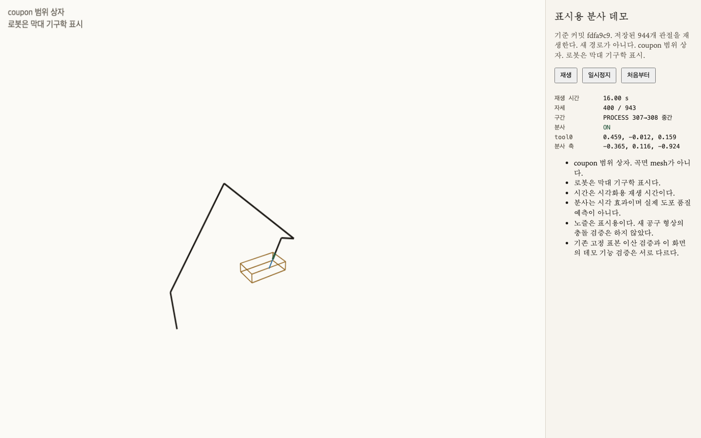
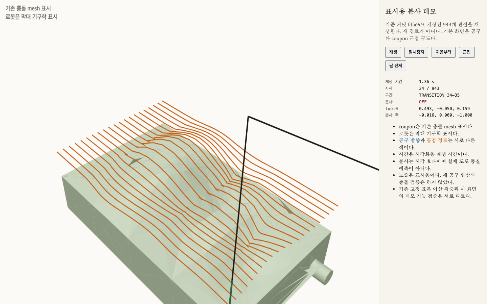

# CAD-less 3D Vision-Guided Robotics

CAD 곡면에서 planning-reference 로봇 궤적까지 연결하는 저장소다. 저장소 이름은 유지한다. 현재 공개된 궤적 성과는 CAD coupon `assets/cad/complex_surface_coupon.step` 기준이다. 이 coupon은 통제된 시험 형상이며 측정 표면의 ground truth가 아니다. 측정 표면으로의 확장은 아직 끝나지 않았다.

검증된 현재 범위는 Universal Robots UR5e의 planning reference다. 그룹은 `ur_manipulator`, 체인은 `base_link` → `tool0`이다. `tool0`은 planning reference TCP이며 실물 공정 공구 TCP가 아니다. 호스트 검증은 Ubuntu 24.04의 ROS 2 Jazzy에서 했다. 아래 DOFBOT Pro와 ROS 2 Humble 절차는 초기 측정 경로이며, 이 궤적 검증의 실행 방법이 아니다.

## 데모

브라우저 재생은 채택된 944개 관절을 화면에서 다시 보여 준다. 재생 시간은 시각화 시간이다. 검증된 궤적 시간 약 195.016초를 이 화면 시간으로 읽지 않는다.

현재 저장소 데모의 간격은 0.20초다. 종료 프레임의 표시 시간은 188.60초다. 그 전 간격 0.04초의 종료 표시 시간은 37.72초였다. 두 값 모두 화면용이며, `2f5abbd`의 궤적 시간과 다르다.

- 저장소 뷰어: [evidence/UR-ANALYTIC-IK-SPRAY-DEMO/viewer/index.html](evidence/UR-ANALYTIC-IK-SPRAY-DEMO/viewer/index.html)
- 공개 페이지: [pf.koraiagent.com/cad-less-robotics/spray-demo](https://pf.koraiagent.com/cad-less-robotics/spray-demo/)

분사는 PROCESS 구간에서만 켜지는 시각 효과다. coupon은 기존 충돌 mesh다. 로봇 표시는 막대 기구학이다. 도포 품질, 실물 안전, 컨트롤러 보간은 이 데모의 결과가 아니다.





## 현재 성과

채택 관절열을 보존한 944점 `moveit_msgs/msg/RobotTrajectory`를 만들고, 점마다 정지하는 5차 Hermite 해석에서 운동 한계와 고정 표본의 공정 정확성·이산 충돌을 검증했다. 커밋은 `2f5abbd`다.

| 항목 | 값 | 근거 |
| --- | --- | --- |
| 관절 점 | 944 | `restore.json`, SHA-256 `35f72af9e3b23b9cb2a4e6133eb24623489ed00762f8ccf40000e618a0998943` |
| 원본 구간 | PROCESS 720, TRANSITION 20 | 같은 채택. 그래프 현은 PROCESS 923, TRANSITION 20 |
| 기하 이산 검사 | 통과 | 위치 최대 0.0009275561673644112 m, 방향 최대 0.007625911618979101 rad. 기준 0.001 m / 0.01 rad |
| 시간 궤적 | 195015588556 ns, 약 195.016초 | 구간마다 속도와 가속도가 0인 5차 시간 스케일 |
| 운동 한계 | 통과 | 속도 최대 0.9294942762833919 rad/s, 가속도 최대 4.999999999826807 rad/s². 한계는 URDF 속도 π rad/s, MoveIt 설정 가속도 5.0 rad/s² |
| 공정 정확성 | 통과 | 표본 92301, 실패 0. 위치 최대 0.0009272856129797934 m, 방향 최대 0.007625911618979101 rad |
| 이산 충돌 | 통과 | 표본 94301, 자체 0, coupon 0 |
| 판정 | `QUINTIC_TIMESCALE_CHECK = PASS` | [evidence/UR-ANALYTIC-IK-QUINTIC-TIMESCALE-R1/report.md](evidence/UR-ANALYTIC-IK-QUINTIC-TIMESCALE-R1/report.md) |

기하 경로의 고정 표본 검사는 [evidence/UR-ANALYTIC-IK-PROCESS-FULL-PATH-DISCRETE/manifest.json](evidence/UR-ANALYTIC-IK-PROCESS-FULL-PATH-DISCRETE/manifest.json)이다. 그 기록의 `time_parameterization`은 `NOT_CLAIMED`로 남아 있다. 시간 검증은 그 파일을 덮어쓰지 않은 뒤의 별도 기록이다.

## 설계 전환

P-022의 MoveIt Cartesian 경로는 `FAIL_CARTESIAN_API` / `CLOSED_FAIL`이다. 동결된 계약 안에서 그 호출을 대체할 구현은 확보하지 못했다. 이 문장은 계획 해법 자체가 없다는 뜻이 아니다.

그 다음 경로는 세 단계로 바뀌었다.

1. 공정 경계 20개를 TRANSITION으로 유지했다. PROCESS 720과 합쳐 원본 구간은 740개다.
2. 944개 관절을 후보 인덱스 224로 한 번에 골랐다. 구간마다 새 기하 탐색을 하지 않았다. 고정 표본 이산 검사는 통과했다. 커밋 `fdfa9c9`.
3. TOTG 첫 평가 `941c69f`는 메시지 생성에는 성공했고, 가속도·공정 정확성·대응 조건에서는 실패했다. TOTG는 기하 경로를 바꿀 수 있다. 이어서 각 관절 직선을 유지한 채 구간마다 정지-정지 5차 시간 스케일을 부여했다. 커밋 `2f5abbd`.

TOTG 실패 기록은 [evidence/UR-ANALYTIC-IK-TOTG-TRAJECTORY-R1/report.md](evidence/UR-ANALYTIC-IK-TOTG-TRAJECTORY-R1/report.md)에 그대로 있다.

## 검증 범위와 한계

이 통과는 planning-reference UR5e에서, 저장된 메시지를 5차 Hermite로 읽은 결과다.

- 각 관절점은 속도 0, 가속도 0에서 멈춘 뒤 다음 점으로 간다. 연속 분사에 맞춘 시간 배분은 아니다.
- 실제 컨트롤러가 이 보간을 쓴다고 검증하지 않았다.
- 표본 사이의 연속 충돌은 검증하지 않았다. 충돌 결과는 `k/100` 이산 표본이다.
- 실물 로봇 실행, 토크, 동역학, jerk 한계는 검증하지 않았다.
- 데모의 분사 표시는 도포 품질이 아니다.
- 측정한 신발 표면의 ProcessPath를 이 궤적으로 확장했다고 말하지 않는다.

## 재현

### UR5e, ROS 2 Jazzy

시간 궤적 검증은 p620의 ROS 2 Jazzy와 MoveIt 2.12.4에서 한 번 수행했다. 생성 코드와 입력 해시는 [evidence/UR-ANALYTIC-IK-QUINTIC-TIMESCALE-R1/](evidence/UR-ANALYTIC-IK-QUINTIC-TIMESCALE-R1/)에 있다. 부모 프로세스가 전체 300초와 주소 공간 8 GiB를 걸었다. 출력 점 상한은 5,000개이고, 이번 메시지는 944점이다.

같은 디렉터리의 `command.txt`가 그 실행의 인자다. 입력 파일은 `restore.json`, UR5e URDF/SRDF, `runs.bin`, `transitions.bin`, `inserts.bin`, coupon 충돌 mesh다. 해시는 `setup.json`에 있다.

### DOFBOT Pro, ROS 2 Humble

아래는 초기 점군 경로다. UR5e 시간 궤적 검증을 재현하지 않는다. macOS에는 Humble이 없다.

```bash
sudo apt install ros-humble-moveit ros-humble-pcl-conversions ros-humble-tf2-sensor-msgs \
  ros-humble-ament-cmake-gtest libpcl-dev
source /opt/ros/humble/setup.bash
cd /path/to/cad-less-robotics
colcon build --cmake-args -DCMAKE_BUILD_TYPE=Release
source install/setup.bash
colcon test --packages-select vision_path_generator robot_controller
colcon test-result --verbose
```

Yahboom MoveIt과 카메라 드라이버를 먼저 띄운 다음:

```bash
ros2 launch robot_controller system_bringup.launch.py
```

실기 명령은 기본으로 꺼져 있다.

```bash
ros2 launch robot_controller system_bringup.launch.py execute_trajectory:=true
```

하드웨어 없이 PCD만 보려면:

```bash
ros2 launch robot_controller system_bringup.launch.py \
  camera_source:=pcd pcd_path:=/absolute/scan.pcd \
  require_transform:=false start_motion_planner:=false
```

## 초기 측정 경로와 과거 이력

이 저장소는 CAD 없이 측정한 표면에서 로봇에 묶이지 않은 6D ProcessPath를 만드는 경로로 시작했다. 2026-10-31 ADR-008은 공정 정의와 측정 표면 경로 생성을 나눈다. Gemini 335L 한 장에서 공정 경계를 자동으로 찾는 일은 핵심의 필수 책임이 아니다. R1 조사는 그 자동 경계를 현재 촬영으로 입증하지 못했고, 기준은 결과를 본 뒤에 낮추지 않았다. 결정 기록은 [evidence/ADR-008/README.md](evidence/ADR-008/README.md)다. P-009 평가는 `FAIL_SURFACE_ASSOCIATION`이다.

### 데이터 흐름

1. Orbbec 드라이버가 `sensor_msgs/PointCloud2`를 발행한다. `camera_node`가 필드를 확인한 뒤 `/vision/camera/points`로 넘긴다.
2. `path_extractor_node`가 VoxelGrid, StatisticalOutlierRemoval, RANSAC 평면 제거, 법선, 2mm 웨이포인트 순서로 `geometry_msgs/PoseArray`(`/vision/waypoints`)를 만든다.
3. `motion_planner_node`가 `arm_group`에 대해 `computeCartesianPath`를 호출한다. 전체 경로가 만들어지고 안전 조건을 통과하며 `execute_trajectory:=true`일 때만 `execute`한다.

디버그 점군은 `/vision/cloud_filtered`, `/vision/cloud_object`다. 계획된 관절 궤적은 `/motion_planner_node/planned_trajectory`에만 나가며, 컨트롤러 명령 토픽으로 직접 쓰지 않는다. 점군 QoS는 `SensorDataQoS`(best effort)다.

`/vision/waypoints`의 P-004 결과는 `camera_depth_optical_frame` 기준이다. camera→base 보정이 없으면 로봇 실행 포즈가 아니다.

`config/dofbot_controllers.yaml`은 Yahboom 문서의 `arm_group_controller`와 `Arm1_Joint`–`Arm5_Joint`를 옮긴 참조 파일이다. 벤더 드라이버가 이미 컨트롤러를 띄우면 이 파일을 중복 로드하지 않는다.

### 처리 규칙

- 단위는 미터다. 센서가 밀리미터면 `input_scale:=0.001`.
- 평면 법선은 평면을 뺀 뒤 제품 점이 있는 쪽으로 맞춘다. 이 부호는 작업면 제거에만 쓴다.
- 표면 법선 부호는 `camera_depth_optical_frame`의 카메라 원점을 향하게 고른다.
- 툴 +Z는 바깥 법선의 반대이고, 툴 +X는 경로 접선이다.
- `path_mode`는 `auto`, `boundary`, `crest`다. 경계는 보이는 점군의 가장자리이며, 재봉선과 같다는 측정은 없다.
- Cartesian 분율이 전체 경로에 못 미치면 실행하지 않는다. `min_fraction` 기본값은 0.95다.
- 원점에서 `max_reach_m`(기본 1 m)를 넘는 포즈는 거절한다.
- `jump_threshold` 기본값 1.0은 검증된 안전 한계가 아니다.

### CAD coupon과 P-022

`freecad-shoe-last-wb` STEP은 geometry 검사 뒤 거절했다. 통과시키려고 증거를 고치지 않는다. P-010A와 ADR-011은 CAD 기술 검증과 footwear 검증을 분리한다. P-011 coupon STEP은 측정 표면의 ground truth가 아니다. P-012는 그 STEP의 법선과 곡률, P-013은 CAD ProcessPath다.

P-022는 그 ProcessPath를 UR5e planning reference로 옮겨 MoveIt Cartesian planning을 실행한 기록이다. 최종 게이트는 `FAIL_CARTESIAN_API`다. 설명은 [evidence/P-022/README.md](evidence/P-022/README.md)다.

### 아직 측정이 없는 항목

- DOFBOT 플래닝 그룹의 문서 기본값은 `arm_group`, 조인트는 `Arm1_Joint`–`Arm5_Joint`다. 확인되지 않은 `Arm6_Joint`는 만들지 않는다.
- 엔드이펙터 링크 기본값은 `Arm5_Link`다. 실제 TCP와 같은지는 확인되지 않았다.
- 핸드아이 변환의 측정값은 없다. `publish_hand_eye_tf:=true`는 측정한 xyz/rpy를 같이 줄 때만 쓴다.
- P-005 배치는 `TEST_ONLY_SYNTHETIC_PLACEMENT`다. calibration이 아니다.

에이전트 운영 원칙은 [AGENTS.md](AGENTS.md)의 Evidence-First Engineering이다.

- [MoveIt 2 Humble Move Group C++ Interface](https://moveit.picknik.ai/humble/doc/examples/move_group_interface/move_group_interface_tutorial.html)
- [Yahboom DOFBOT Pro MoveIt2 Configuration](https://www.yahboom.net/public/upload/upload-html/1768547833/MoveIt2%20Configuration.html)
- [Orbbec ROS 2 point cloud](https://orbbec.github.io/OrbbecSDK_ROS2/en/source/camera_devices/4_application_guide/point_cloud.html)
